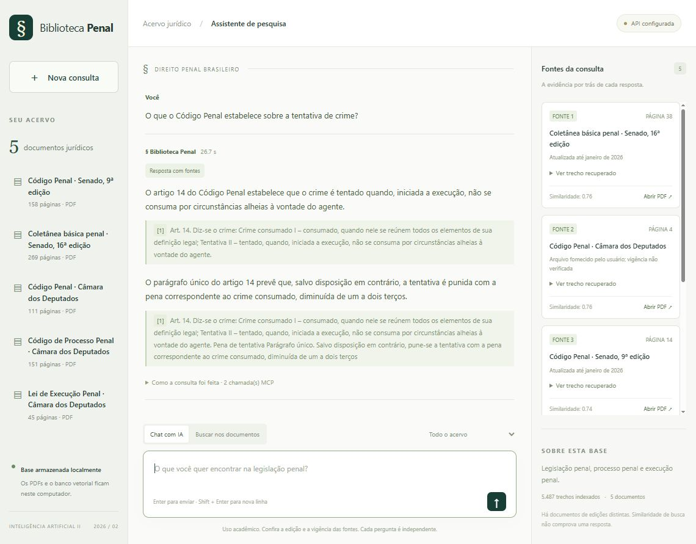
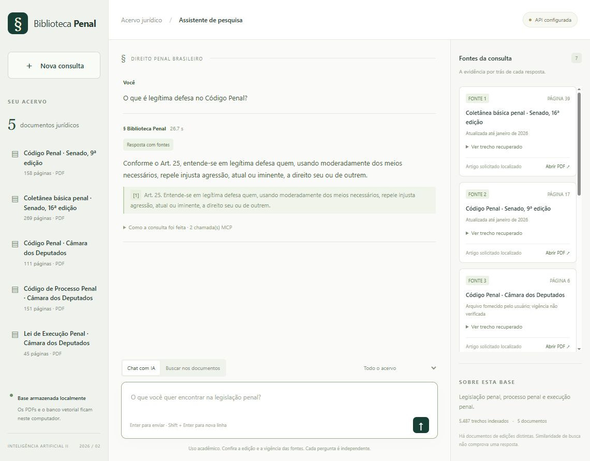
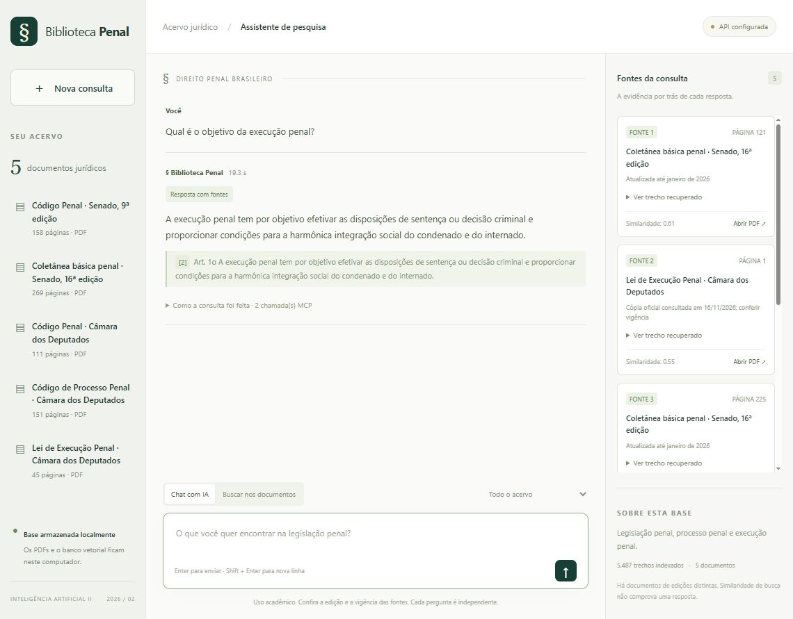

# Correção das perguntas iniciais — 16/11/2026

As três sugestões da página inicial foram testadas no navegador em **Chat com IA**, com Gemini e ferramentas MCP reais. Todas exibiram **Resposta com fontes** e aprovação da validação de saída.

| Pergunta | Resultado observado |
|---|---|
| O que é legítima defesa no Código Penal? | Resposta com fonte e citação do artigo 25; chamada MCP solicitada pelo modelo |
| O que o Código Penal estabelece sobre a tentativa de crime? | Resposta com fontes do artigo 14; chamada MCP solicitada pelo modelo |
| Qual é o objetivo da execução penal? | Resposta com citação da Lei de Execução Penal; chamada MCP solicitada pelo modelo |

Os registros do navegador estão em [`evidencias_perguntas_padrao.json`](evidencias_perguntas_padrao.json).

## Causas e correções

1. **HTTP 503 do provedor:** o adaptador encerrava a consulta logo no primeiro erro. Agora realiza até três tentativas para falhas temporárias, com espera crescente e limite de tempo. Erros de autenticação, configuração e cota não são repetidos.
2. **Busca por “tentativa”:** a remoção de palavras genéricas deixava somente um termo ambíguo para o embedding e a busca descartava os artigos pertinentes. Para um único termo de conteúdo, a pergunta original agora preserva o contexto jurídico.
3. **Citação sem cabeçalho do artigo:** o modelo podia mencionar “artigo 14” na explicação e citar só o corpo, fazendo a guarda numérica bloquear a resposta. O prompt orienta a incluir esse cabeçalho. O código também pode ampliar uma citação já literal para incluir o cabeçalho da mesma seção do chunk, sem inventar texto nem tomar números de outros artigos. A resposta continua passando por todos os critérios de validação.
4. **Resposta inválida:** há uma única tentativa de correção pelo modelo, com o motivo da rejeição. Uma segunda falha continua bloqueada.
5. **API temporariamente indisponível:** após as tentativas limitadas, a interface mostra trechos literais locais no corpo da conversa e informa que não houve geração de explicação por IA. O status é `document_fallback`; não é apresentado como sucesso de inferência do Gemini.
6. **Painel de fontes:** o layout permite que a coluna principal encolha sem empurrar as referências para fora da tela.

## Validação

- **46 testes automatizados aprovados**, incluindo recuperação após 503, esgotamento de tentativas, proteção de credenciais, respeito a `Retry-After`, ausência de repetição em erros permanentes, correção de citações e fallback documental.
- Verificação MCP real aprovada, incluindo recuperação das três perguntas iniciais, consulta ausente e bloqueio de prompt injection.
- Três perguntas iniciais aprovadas pela interface com Gemini real.

Essas correções não eliminam as limitações semânticas dos guardrails registradas na auditoria: o filtro de domínio por palavras-chave e a comparação lexical de afirmações ainda exigem revisão e melhorias próprias.

